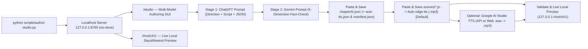

# Design

## Context

StackRewind's **Console vs. Cartridge** architecture keeps `index.html`, `css/`, and `js/` strictly read-only while all volumes, chapters, SVG scenes, TTS manifests, and audio live under `content/` and `assets/`. Authors using free-tier web chat accounts benefit from dividing work across models—**ChatGPT** for direction/script/JSON, **Gemini** for fact-checking, and **Claude** for looping dual-theme SVG animations—and need an immediate local webpage preview to visually verify animations and Light/Dark themes before committing. See `proposal.md` and `specs/chat-prompt-authoring-cli/spec.md`.

## Goals / Non-Goals

**Goals:**
- Provide a single-file, zero-dependency Python 3 (`stdlib` only) localhost server + Studio GUI (`scripts/author-studio.py`).
- Serve both the Studio workbench (`/studio`) and the real local StackRewind reader (`/`) from the same `127.0.0.1:<port>` origin with `Cache-Control: no-store` so refreshing the preview tab immediately loads newly pasted SVG `.js` modules.
- Support free-tier token limits cleanly by splitting Stage 3 (Claude) into per-scene standalone Copy cards (`p01.js`, `p02.js`, …) plus an optional single staged `"NEXT"` prompt and a `--compact` exemplar toggle.
- Let authors paste AI outputs directly into `content/` safely, run `generate-tts.mjs` and `validate-cartridge.mjs`, and open the deep-linked chapter preview (`/#<volume>/<chapterId>/1`) in one click.

**Non-Goals:**
- Calling paid/external LLM APIs directly (all AI turns happen via copy/paste in the user's free web chat tabs).
- Editing Read-Only Console files (`index.html`, `css/`, `js/`).
- Replacing `.agents/skills/*` inside agentic IDEs.

## Architecture & Workflow



## Decisions

### 1. Single Self-Contained Python Script (`scripts/author-studio.py`)
- **Decision**: Bundle the HTTP server, JSON APIs, prompt builders, and embedded Studio HTML/CSS/JS inside `scripts/author-studio.py` using only Python 3 stdlib (`argparse`, `http.server`, `json`, `pathlib`, `re`, `shutil`, `subprocess`, `threading`, `urllib.parse`, `webbrowser`).
- **Rationale**: Zero `pip install`, zero build step, zero pollution of Console `index.html`/`css/`/`js/`, and trivial one-command startup (`python scripts/author-studio.py`).
- **CLI Flags**:
  - `--port <int>`: Preferred loopback port (default `8765`, auto-falls back to free port `0` if busy).
  - `--no-open`: Start server without calling `webbrowser.open` (for headless/automated tests).
  - `--compact`: Default Stage 3 Claude prompts to compact mode (omit full exemplar SVG module).
  - `--exemplar <path>`: Override default exemplar scene (`content/networking/scenes/net-ch1-p04.js`).

### 2. HTTP Routes & JSON API Contract
- `GET /studio` → Serves the self-contained Multi-Model Authoring Studio GUI.
- `GET /` (and static assets `css/`, `js/`, `content/`, `assets/`) → Serves the local StackRewind reader cleanly with `Cache-Control: no-store, no-cache, must-revalidate` so ES module SVG scene edits never stick in browser cache.
- `GET /api/state` → Returns `manifest.json` volumes/chapters, per-chapter file presence (`chapter<N>.json`, `tts.json`, scenes, `.mp3`s), and last-page cliffhanger summary for continuity.
- `POST /api/prompts/chatgpt` → Generates Stage 1 ChatGPT prompt (Volume Roadmap or Chapter Script + JSON) grounded in live repo state and optional saves under `prompts/`.
- `POST /api/prompts/gemini` → Generates Stage 2 Gemini 5-dimension `/fact-check-chapter` audit prompt from pasted text or saved `chapter<N>.json`.
- `POST /api/prompts/claude` → Generates Stage 3 Claude strictly-SVG prompts (`scenes[]` per-page standalone prompts + `stagedPrompt` single `"NEXT"` prompt), obeying `compact` toggle.
- `POST /api/save/volume` → Scaffolds `content/<volume>/scenes/looping-scene.js` (copied from `content/networking/scenes/looping-scene.js`), `content/<volume>/tts/`, and registers volume in `content/manifest.json`.
- `POST /api/save/chapter` → Strips markdown code fences, validates JSON schema keys, writes `content/<volume>/chapter<N>.json`, auto-generates synchronized `content/<volume>/tts/<assetPrefix>-tts.json`, updates `content/manifest.json` (`status: "published"` + chapter entry), and when `autoTts` is true (default in GUI), automatically runs paced `edge-tts` synthesis for all pages.
- `POST /api/save/scene` → Strips markdown code fences, verifies JS exports (`mount`/`unmount`/`pause`/`resume`/`replay` or `createLoopingScene`) and `--sr-` token presence, and writes `content/<volume>/scenes/<sceneModule>.js`.
- `POST /api/save/audio` → Accepts an uploaded/base64 `.wav` or `.mp3` downloaded from the free Google AI Studio web speech UI and writes or transcodes it via `ffmpeg` strictly to `assets/audio/<assetPrefix>-p<00>.mp3` (`^assets/audio/[a-z0-9-]+-p\d{2}\.mp3$`).
- `POST /api/run/tts` → Supports `provider: "edge-tts"` (default: paced per-page `node scripts/generate-tts.mjs --chapter ... --page <p> --overwrite` with up to 3 retries) OR `provider: "google-ai-studio"` (stdlib `urllib.request` POST to `https://generativelanguage.googleapis.com/v1beta/models/{model}:generateContent` with `x-goog-api-key` from `os.environ.get("GEMINI_API_KEY")` or session-only request input, `responseModalities: ["AUDIO"]`, `speechConfig.voiceConfig.prebuiltVoiceConfig.voiceName`, decoding PCM 24kHz / WAV and transcoding via `ffmpeg` to `assets/audio/<assetPrefix>-p<00>.mp3`).
- `POST /api/run/validate` → Runs `node scripts/validate-cartridge.mjs` and returns `{ ok, exitCode, stdout, stderr }`.

### 3. Security & Console Boundary Guardrails
- Bind `ThreadingHTTPServer` strictly to `127.0.0.1` (never `0.0.0.0`).
- Enforce strict slug regexes (`^[a-z0-9]+(?:-[a-z0-9]+)*$` for volumeId, `^[a-z0-9-]+-p\d{2}$` for `sceneModule`) and verify every write path resolves inside `<repo>/content/` (`Path.resolve().is_relative_to(CONTENT_DIR)`) or `<repo>/assets/audio/` for audio upgrades (`Path.resolve().is_relative_to(AUDIO_DIR)`), guaranteeing Read-Only Console files (`index.html`, `css/`, `js/`) can never be overwritten via the API.
- Never write, log, or echo `GEMINI_API_KEY` to disk or `/api/state`. Keep `tts/<assetPrefix>-tts.json` `"voice": "en-US-AndrewMultilingualNeural"` so `validate-cartridge.mjs` continues passing cleanly even when `.mp3` files are upgraded via Google AI Studio.

### 4. Studio GUI Design (`/studio`)
- Clean, responsive 2-theme (Warm Paper / Noir aesthetic matching StackRewind) single-page workbench with:
  - **Top Bar**: Active Volume/Chapter selector + prominent **Open Live Local Preview (`/#<vol>/<ch>/1`)** button + **Validate Cartridge** status pill.
  - **Step 1 Tab (Free ChatGPT)**: New Chapter vs. New Volume toggle, interview fields, Copy Prompt button, Paste & Save Chapter JSON / Volume Roadmap box (with **Auto-generate default `edge-tts` on save** checked by default).
  - **Step 2 Tab (Free Gemini)**: Auto-loads saved/pasted Chapter JSON, Copy Fact-Check Prompt button, Paste & Update Verified JSON box.
  - **Step 3 Tab (Free Claude — Strictly SVG)**: Compact toggle (`Full Exemplar` vs. `Compact`), **Per-Scene Cards (`p01.js..p0K.js`)** each with Copy Prompt + Paste & Save Scene JS + live status badge (`Saved` / `Missing`), plus an optional **Single Staged `"NEXT"` Prompt** sub-tab.
  - **Step 4 Panel (Narration Audio, Validate & Preview)**: Shows **Default `edge-tts` (`en-US-AndrewMultilingualNeural`)** auto-run status + Re-run button, **Optional Google AI Studio Upgrade** (API key/model/voice/style cue OR Copy Narration + `.wav`/`.mp3` upload per page for free web users), **Validate Cartridge** button with console log, and **Open Live Local Preview**.

## Risks / Trade-offs

- **Browser caches dynamic `import()` SVG modules across edits** → *Mitigation*: Every HTTP response from `author-studio.py` sends `Cache-Control: no-store, no-cache, must-revalidate`.
- **Microsoft Edge TTS throttling on sequential pages** → *Mitigation*: Default `edge-tts` runs page-by-page with short pacing and up to 3 automatic retries per page.
- **Missing `ffmpeg` when upgrading via Google AI Studio PCM/WAV** → *Mitigation*: Default `edge-tts` writes `.mp3` directly without `ffmpeg`; Google AI Studio checks `shutil.which("ffmpeg")` and returns a clear actionable message if absent (while direct `.mp3` upload always works).
- **Accidental invalid JSON or malformed paste from chat** → *Mitigation*: Server strips outer ```` ```json ```` / ```` ```js ```` fences automatically and returns clear HTTP `400` validation errors before touching disk.
